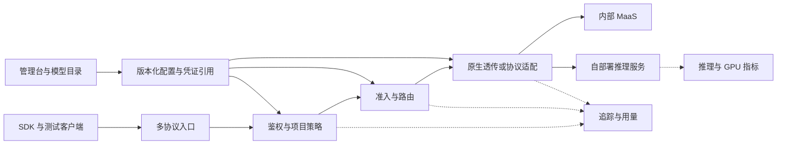

# 架构与治理

面向 70–80 人，优先复用现成网关与管理台，模型目录可先用内部文档。以下为逻辑职责划分，不要求每个模块独立部署。单实例可用于可接受维护停机的服务；按可用性与容量实测决定冗余。具体拓扑见[小团队方案](10-open-source-plan.md)。

## 控制面与数据面

控制面管理主体、项目、Key、模型、部署、能力和策略。数据面读取已校验的快照并执行请求。日志异步写入；管理界面故障不阻断已有授权。鉴权或预算状态不可用时默认拒绝新请求，任何有限宽限都需要明确约束与审计。

逻辑请求关联多个上游尝试，每次尝试独立记账。模型可有多个部署；不能把模型名、部署名和平台别名混为一个字段。

## 身份和网络

内部 Key 绑定项目，上游凭证托管于密钥系统。短期令牌刷新使用并发协调与过期缓冲，避免刷新风暴。

上游地址由管理员登记，调用者不能任意指定 URL 或覆盖认证头。透传、重定向和多模态远程 URL 都遵循目的地策略。示例使用 .invalid 域名。

## 请求策略

| 行为 | 严格调试 | 稳定服务 |
| --- | --- | --- |
| 目标 | 固定部署与配置 | 明确的候选部署集合 |
| 重试 | 默认关闭，可显式启用 | 分类且限制总次数和总耗时 |
| 跨模型切换 | 关闭 | 授权并检查能力 |
| 答案缓存 | 关闭 | 项目隔离且缓存键版本化 |
| 参数转换 | 拒绝静默有损转换 | 仅允许已声明策略 |

不同量化、模板和 LoRA 不自动视为等价部署。先按权限、数据去向和能力过滤，再考虑健康与负载。

客户端、网关和 MaaS 可能分别重试，必须限定总尝试预算。上游结果未知的超时不等于没有计费。已输出的流、资源创建及有副作用的内置工具不能盲目重试。

## 准入与健康

MaaS 配额按真实共享账号或部署控制；多个内部 Key 不会创造新上游额度。自部署采用并发、上下文上限、有界排队和截止时间，区分网关队列和引擎队列，防止长队列叠加。

区分进程存活、模型就绪、小规模合成调用。探活限制频率，避免生成请求本身消耗大量资源。指标不可得时先采用静态限额，不宣称容量感知。

## 追踪与成本

逻辑请求记录 request_id、项目、请求模型、实际部署、策略版本和最终状态；尝试记录 attempt_id、上游请求 ID、错误类别与时序。

拆分网关排队、首事件、首内容和总耗时；心跳不计作首 Token。高基数请求 ID 和 Prompt 不作为指标标签。Token 速率只在口径可比时比较。

区分上游报告、估算和待核算用量；区分 MaaS 费用与自部署分摊。自部署可按 GPU 小时分摊，但需记录空闲成本，不能宣称每个请求都有精确 GPU 成本。

## 日志与缓存

默认元数据，正文采集限时、限项目且可删除；审计和 Prompt 分别设留存期。导出剥离密钥与认证头。

答案缓存、语义缓存、推理前缀缓存分别统计。答案缓存至少隔离项目、模型配置、参数和工具定义，不得绕过授权。调试关闭网关答案缓存，但不承诺能关闭 MaaS 未暴露的前缀缓存。
