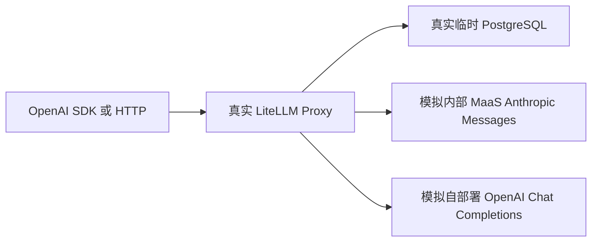

# LiteLLM 与临时 PostgreSQL 完整调用 POC

使用未修改的 **LiteLLM Proxy 1.109.1**、真实临时 PostgreSQL，以及两个本地模拟模型供应商，跑通原生 Key 管理、协议转换、流式输出、权限、限额和用量入库。

**PG 不是 mock。** 通过 `pgserver` 包提供的 PostgreSQL 二进制启动独立数据库，不需要已有数据库、Docker 或 GPU。只有模型推理上游是确定性模拟服务；不会调用真实模型厂商，也不产生模型 API 费用。

## 启动

已验证环境为 Linux x86_64、Python 3.12。需要 Python venv 支持、Node.js 与首次安装/Prisma 初始化所需的网络。`pgserver` 包有平台限制；其他平台需先确认其 wheel。数据库以普通用户运行。

从仓库根目录执行：

```bash
make install
make poc
```

`make install` 使用 `poc/requirements.lock` 安装固定依赖。若系统缺少 venv，先通过系统包管理安装 Python venv 支持。首次生成 Prisma 客户端可能需要下载引擎，请保留 TLS 验证并配置正确代理/证书。

启动后：

- API：`http://127.0.0.1:4000/v1`
- 原生管理台：`http://127.0.0.1:4000/ui`
- OpenAPI：`http://127.0.0.1:4000/openapi.json`
- 管理员用户名、随机密码、管理 Key 和临时 DB 连接信息保存在启动输出指定的 `credentials.json`，权限为 0600。

默认只监听本机。每次启动创建独立运行目录和数据库，端口 4000 冲突时使用：

```bash
.venv/bin/python -m poc.run --port 4400
```

Ctrl-C 会停止本次启动的网关、模拟上游和 PG；不会停止其他服务。数据库与日志保留在被 Git 忽略的 `poc/.runtime/<run>/`，方便排障。每次新运行重新初始化，旧目录不会被当作生产数据复用；需要释放磁盘时，在确认服务停止后删除对应运行目录。

## 一次完成发 Key 与双上游调用

使用启动时给出的实际文件路径：

```bash
make demo CREDENTIALS=poc/.runtime/<run>/credentials.json
```

脚本先调用原生 `/user/new` 创建普通用户，再调用 `/key/generate` 发放绑定该用户的受限开发 Key，再请求两种模型。Key 只写入同目录 `developer.json`，不会打印到终端。

开发者使用 OpenAI SDK：

```python
import json
from pathlib import Path
from openai import OpenAI

credential = json.loads(Path('poc/.runtime/<run>/developer.json').read_text())
client = OpenAI(**credential, max_retries=0)
response = client.chat.completions.create(
    model='maas-chat',
    messages=[{'role': 'user', 'content': 'hello'}],
    max_tokens=64,
)
print(response.choices[0].message.content)
```

普通开发者使用绑定 user_id 的虚拟 Key；管理 Key 仅用于管理 API。不能用没有归属的 Key 验证用户隔离；metadata 中的 project 只是归属标签，不是授权边界。原生管理台可查看模型、创建 Key 和检查用量。本 POC 的初始管理员登录用于本机演示；企业身份和组织权限需独立验收。

## 请求链路



| 调用模型名 | 真正收到请求的本地端点 | 验证内容 |
| --- | --- | --- |
| maas-chat | `/maas/v1/messages` | OpenAI 请求到 Anthropic 协议的转换、原生 Messages 入口、流式事件转换 |
| local-chat | `/local/v1/chat/completions` | 兼容接口、工具循环、结构化输出与故障注入 |

上游各自验证认证头；端点命中次数可用于证明错误时没有偷偷重试或跨模型切换。模拟服务只记录计数，不存 Prompt 或凭证。

## 验收

```bash
make test
```

测试会自动创建另一套隔离 PG、上游和 LiteLLM，使用随机端口，结束后关闭服务。无需先执行 `make poc`。JUnit 结果保存在 `poc/.runtime/junit.xml`；测试临时目录由 pytest 管理。

验收覆盖：真实 PG 与哈希 Key、两种协议、SDK 流式、工具循环、JSON Schema、模型白名单、无效和过期 Key、撤销、管理权限、跨 Key 访问、RPM、并发、预算结算后拦截、错误透传、超时、不重试不切换、用量入库、正文不落库、代理重启后 Key 可用。最终实测状态见[验收报告](RESULTS.md)。

可用合成 Prompt 手动触发：`[poc:429]`、`[poc:500]`、`[poc:timeout]`、`[poc:slow]`。仅存在于模拟上游，不是生产协议的一部分。

## 真实与模拟边界

| 部分 | 本 POC |
| --- | --- |
| LiteLLM 路由、协议、鉴权、管理 API | 真实原生代码，无自研替代网关 |
| PG、Prisma 表结构、Key 与 spend 数据 | 真实 PostgreSQL，独立临时集群 |
| 模型回答、Token、价格 | 合成结果及演示价格；不是准确计费或模型质量测试 |
| 工具与结构化能力 | 验证传输和解析，不证明真实模型满足 Schema 或会正确选工具 |
| 预算 | 验证记账后拦截；不宣称并发请求严格零超支 |
| 流式 | 验证事件与 SDK 解析；不代表真实上游取消或断流行为 |
| 容量与可用性 | 单进程功能验证；没有验证 80 人负载、多副本或生产 SLA |
| 管理台 | 复用原生页面；页面可访问与浏览器完整交互分开记录 |

`pgserver` 在此提供 PostgreSQL 16.2 二进制，供隔离 POC 使用。生产部署应选择受维护的 PostgreSQL 版本与备份方案。初始化对本次新建数据库使用 `prisma db push`，不验证生产迁移；运行器不会使用外部传入的 DATABASE_URL。启动脚本不是生产部署脚本。

## 替换成真实上游

先复制 `config.yaml` 到私有配置目录，把服务地址与凭证引用替换成真实 MaaS 或推理服务；重新验证协议、模型版本、工具解析器和额度。保持固定部署别名、关闭自动 fallback 和答案缓存。不要直接把测试用故障指令、价格或假 Token 用量用于生产。

此运行器刻意只启动本地模拟环境。接真实上游时采用独立部署与凭证配置，不修改公开示例写入公司地址或密钥。

## 文件

- `config.yaml`：LiteLLM 原生配置，两类上游与严格调试策略。
- `runtime.py`、`run.py`：进程与临时数据库生命周期。
- `mock_upstreams.py`：独立的两个 HTTP 上游协议模拟器。
- `demo.py`：真实管理 API 发 Key 和双模型演示。
- `tests/`：HTTP、SDK 与 PostgreSQL 集成验收。
- `requirements.in`、`requirements.lock`：直接依赖与完整固定版本。

官方参考：[LiteLLM 虚拟 Key](https://docs.litellm.ai/docs/proxy/virtual_keys)、[原生部署](https://docs.litellm.ai/docs/proxy/docker_quick_start)、[pgserver](https://pypi.org/project/pgserver/)。
